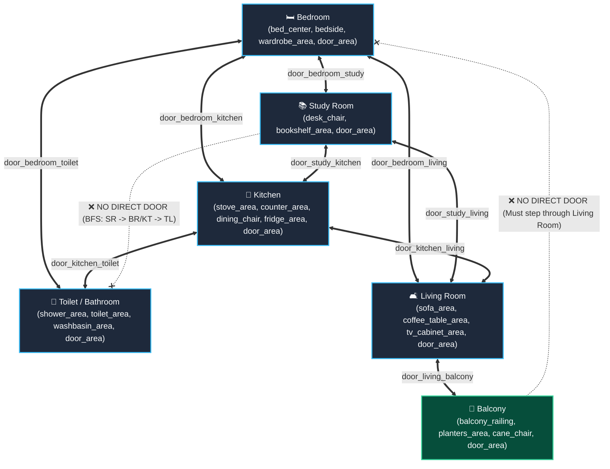
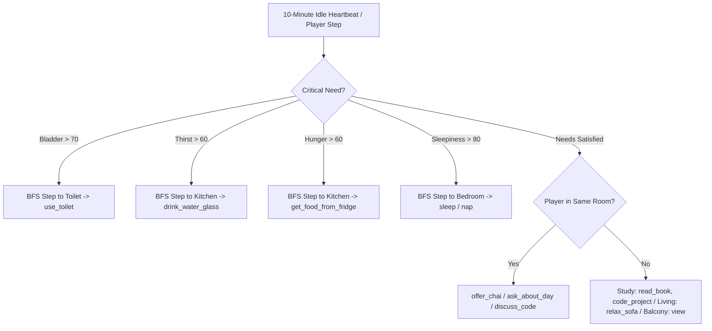

# Universal Story Blueprint (Modular Capability Map)
> **Role**: Authoritative System Topology, Object-Action Matrix & Cross-Room Interaction Specification.  
> **Narrative Tree Companion**: See [`UNIVERSAL_STORY_TREE.md`](file:///home/no/applications/Game/life-simulation/story/UNIVERSAL_STORY_TREE.md) for the in-depth, verbatim branching action tree with full flavor text and step-by-step room walkthroughs.  
> **Source of Truth**: Grounded directly against `src/config/` (rooms, objects, actions, world) and `src/engine/` (`ActionEngine`, `MovementEngine`, `StateManager`, `NeedsEngine`, `AIDecisionEngine`).  
> **Status Legend**:  
> - `✅ Ready`: Fully implemented, wired, and verified with 100% test coverage across all test suites.  
> - `⚠️ Discrepancy`: Action defined in JSON, but blocked at runtime due to mismatched target types, missing interaction lists, or missing connections.  
> - `❌ Missing`: Action referenced on an object, but missing an action definition in `src/config/actions/`.

---

## 🗺️ Architectural Room Topology & Connectivity Graph



### Movement & Spatial Navigation Rules
- **Locomotion Requirement**: Characters MUST be in `standing` posture to walk across doorways.
- **Topology Enforcement**: Verified by `MovementEngine.ts`. Multi-room pathfinding uses Breadth-First Search (BFS) for autonomous AI navigation.
- **Sub-room Positions**: Moving into a room places the character at its configured landing area (`*_door_area`) or default landing coordinates.

---

## 🧍 Module 1: Posture & Locomotion State Machine

> **Governing Files**:  
> - Config: `src/config/actions/movement.json`, `src/config/actions/body_actions.json`, `src/config/world.json`  
> - Engine: `src/engine/MovementEngine.ts`, `src/engine/ActionEngine.ts`, `src/engine/BodyStateEngine.ts`

### 1. Posture Transition Graph
```mermaid
stateDiagram-v2
    [*] --> Lying: Simulation Start (Mohit @ bed_center)

    state Lying {
        turn_left --> Lying: Rotate face left
        turn_right --> Lying: Rotate face right
        sleep --> Lying: Sleep 7h (energy +80, sleepiness -85)
        nap --> Lying: Nap 45m (energy +35, sleepiness -40)
        meditate --> Lying: Meditate 10m (stress -15)
        sit_up_in_bed --> Sitting: Sit up directly on the bed
    }

    Lying --> Standing: get_up (moves to bedside)
    
    state Sitting {
        stand_up --> Standing: Stand up at current position
        get_up --> Standing: Stand up (moves to bedside if on bed)
        lie_down_bed --> Lying: Recline back onto bed
        sit_down_sofa --> Sitting: Sit on living room sofa
        sit_down_cane_chair --> Sitting: Sit on balcony cane chair
        nap --> Sitting: Nap 45m
        meditate --> Sitting: Meditate 10m
    }

    state Standing {
        sit_down_bed --> Sitting: Sit on bed edge
        sit_down_study_chair --> Sitting: Sit at study desk
        sit_down_kitchen_stool --> Sitting: Sit at dining counter
        sit_down_sofa --> Sitting: Sit on living room sofa
        sit_down_cane_chair --> Sitting: Sit on balcony cane chair
        lie_down_bed --> Lying: Lie down onto bed
        stretch_body --> Standing: Stretch limbs (+12 energy)
        tidy_room --> Standing: Tidy room items
        walk_to_room --> Standing: Walk through connected door
    }
```

### 2. Locomotion & Posture Matrix
| Action ID | Category | Status | Preconditions | Effect & Posture Delta | Target Position |
| :--- | :--- | :---: | :--- | :--- | :--- |
| `get_up` | body | ✅ Ready | `posture: ["lying", "sitting"]`, in bedroom | Posture $\rightarrow$ `standing` | `bedside` |
| `sit_up_in_bed` | body | ✅ Ready | `posture: ["lying"]`, pos: `bed_center` | Posture $\rightarrow$ `sitting` | `bed_center` |
| `stand_up` | body | ✅ Ready | `posture: ["sitting"]` | Posture $\rightarrow$ `standing` | Current position |
| `sit_down_bed` | body | ✅ Ready | `posture: ["standing"]`, in bedroom | Posture $\rightarrow$ `sitting` | `bed_center` |
| `sit_down_study_chair`| body | ✅ Ready | `posture: ["standing"]`, in study | Posture $\rightarrow$ `sitting` | `desk_chair` |
| `sit_down_kitchen_stool`| body| ✅ Ready | `posture: ["standing"]`, in kitchen | Posture $\rightarrow$ `sitting` | `dining_chair` |
| `sit_down_sofa` | body | ✅ Ready | `posture: ["standing"]`, in living room | Posture $\rightarrow$ `sitting` | `sofa_area` |
| `sit_down_cane_chair`| body | ✅ Ready | `posture: ["standing"]`, on balcony | Posture $\rightarrow$ `sitting` | `cane_chair` |
| `lie_down_bed` | body | ✅ Ready | `posture: ["standing", "sitting"]`, bedroom | Posture $\rightarrow$ `lying` | `bed_center` |
| `turn_left` / `turn_right` | body | ✅ Ready | Any posture | Orientation changes 90° | Unchanged |
| `walk_to_bedroom` | movement | ✅ Ready | `posture: ["standing"]`, in connected room | Moves to bedroom | `bedroom_door_area` |
| `walk_to_study_room` | movement | ✅ Ready | `posture: ["standing"]`, in connected room | Moves to study | `study_door_area` |
| `walk_to_kitchen` | movement | ✅ Ready | `posture: ["standing"]`, in connected room | Moves to kitchen | `kitchen_door_area` |
| `walk_to_toilet` | movement | ✅ Ready | `posture: ["standing"]`, in connected room | Moves to toilet | `toilet_door_area` |
| `walk_to_living_room`| movement | ✅ Ready | `posture: ["standing"]`, in connected room | Moves to living room | `entrance_door_area` |
| `walk_to_balcony` | movement | ✅ Ready | `posture: ["standing"]`, in living room | Moves to balcony | `balcony_door_area` |

---

## 🛏️ Module 2: Bedroom (Rest, Wardrobe, Dressing & Nightstand)

> **Governing Files**:  
> - Config: `src/config/rooms/bedroom.json`, `src/config/objects.json`, `src/config/actions/daily_activities.json`, `src/config/actions/interactions.json`  
> - Theme & UI: `public/themes/room-bedroom.css`, `public/app.js` (positions: `bed_center`, `bedside`, `wardrobe_area`, `bedroom_door_area`)

### 1. Bedroom Flow Diagram
```mermaid
flowchart TD
    Bed[bed_001: Wooden Bed] -->|sleep (lying)| Rested[Sleep 7h: Energy 100%]
    Bed -->|sit_up_in_bed (lying)| SittingBed[Posture: Sitting in Bed]
    Bed -->|make_bed (standing)| BedNeat[State: neat]

    Lamp[lamp_bedroom_001: Bedside Lamp] -->|turn_on_lamp| LampLit[State: on]
    LampLit -->|bedtime_reading (holding book)| CozyRead[Sleepiness +10, Energy -5, Stress -15]
    LampLit -->|turn_off_lamp| LampDark[State: off]

    Wardrobe[wardrobe_001: Teakwood Wardrobe] -->|open_wardrobe| WardrobeOpen[State: open]
    WardrobeOpen -->|wear_sleepwear| Sleepwear[Kurta-Pyjama, Barefoot, Stress -5]
    WardrobeOpen -->|wear_casual| Casual[T-Shirt, Track Pants, Sandals]
    WardrobeOpen -->|wear_work_wear| Formal[Linen Shirt, Tailored Trousers, Loafers]
    WardrobeOpen -->|close_wardrobe| WardrobeClosed[State: closed]

    Phone[phone_001: Mohit's Phone] -->|pick_up_item| CarryPhone[Carried across rooms]
    CarryPhone -->|check_messages / play_alarm / listen_music_phone| PhoneDone[Mobile connectivity everywhere]
```

### 2. Bedroom Object & Action Matrix
| Object Name & ID | Action ID | Status | Preconditions | State & Need Deltas | Agent Notes / Verification |
| :--- | :--- | :---: | :--- | :--- | :--- |
| **Wooden Bed**<br/>`bed_001` | `sleep` | ✅ Ready | `posture: ["lying"]`, pos: `bed_center` | Time +7h, Energy +80, Sleepiness -85 | Primary sleep cycle |
| | `nap` | ✅ Ready | `posture: ["lying", "sitting"]` | Time +45m, Energy +35, Sleepiness -40 | Quick afternoon recharge |
| | `sit_up_in_bed` | ✅ Ready | `posture: ["lying"]`, pos: `bed_center` | Posture $\rightarrow$ `sitting` | Direct rise in bed |
| | `make_bed` | ✅ Ready | `posture: ["standing"]`, bed rumpled | Bed state $\rightarrow$ `neat`, Happiness +5 | Morning chore |
| **Bedside Lamp**<br/>`lamp_bedroom_001` | `turn_on_lamp` | ✅ Ready | Lamp state: `off` | Lamp state $\rightarrow$ `on` | Warm brass illumination |
| | `turn_off_lamp` | ✅ Ready | Lamp state: `on` | Lamp state $\rightarrow$ `off` | Lights off for sleep |
| | `bedtime_reading` | ✅ Ready | Sitting/lying in bed, holding book, lamp `on`| Sleepiness +10, Stress -15, Studiousness +10| Nighttime relaxation |
| **Teakwood Wardrobe**<br/>`wardrobe_001` | `open_wardrobe` | ✅ Ready | `posture: ["standing"]`, state: `closed` | Wardrobe state $\rightarrow$ `open` | Doors swing open |
| | `close_wardrobe` | ✅ Ready | `posture: ["standing"]`, state: `open` | Wardrobe state $\rightarrow$ `closed` | Doors shut tight |
| | `change_clothes` | ✅ Ready | Wardrobe open, standing | Confidence +10, Stress -5 | Swaps outfit |
| | `wear_sleepwear` | ✅ Ready | Wardrobe open, standing | Kurta-Pyjama, Barefoot | Night rest attire |
| | `wear_casual` | ✅ Ready | Wardrobe open, standing | T-Shirt & Track Pants | Home relaxation |
| | `wear_work_wear` | ✅ Ready | Wardrobe open, standing | Linen Shirt & Trousers | Sharp outdoor wear |
| **Copper Flask**<br/>`water_flask_001` | `pick_up_item` | ✅ Ready | `holding: "none"`, flask not held | Held in hand, portable | Carriable across rooms |
| | `sip_from_flask` | ✅ Ready | State: `full` or `half` | Thirst -15, State $\rightarrow$ `half` | Preserves water |
| | `drink_from_flask` | ✅ Ready | State: `full` or `half` | Thirst -35, State $\rightarrow$ `empty` | Drains bottle |
| | `put_down_item` | ✅ Ready | Currently holding flask | Placed at current position | Can drop anywhere |
| **Mohit's Phone**<br/>`phone_001` | `pick_up_item` | ✅ Ready | `holding: "none"` | Held in hand, fully portable | Carriable to all rooms |
| | `check_phone` | ✅ Ready | In room or holding | Stress -5, Happiness +5 | Screen check |
| | `check_messages` | ✅ Ready | In room or holding | Loneliness -10, Happiness +8 | WhatsApp / texts |
| | `play_alarm` | ✅ Ready | In room or holding | Energy +5, Sleepiness -10 | Gentle chimes |
| | `listen_music_phone`| ✅ Ready| In room or holding | Stress -15, Happiness +10 | Hindi indie & lo-fi |

---

## 📚 Module 3: Study Room (Knowledge, Engineering & Roommate Social)

> **Governing Files**:  
> - Config: `src/config/rooms/study_room.json`, `src/config/objects.json`, `src/config/actions/daily_activities.json`, `src/config/actions/interactions.json`  
> - Theme & UI: `public/themes/room-study.css`, `public/app.js` (positions: `desk_chair`, `bookshelf_area`, `study_door_area`)

### 1. Study Room Flow Diagram
```mermaid
flowchart TD
    PC[computer_001: Desktop PC] -->|turn_on_computer| PCOn[State: on]
    PCOn -->|code_project (sitting)| CodeDone[Studiousness +20, Energy Satisfaction +10, Boredom -15]
    PCOn -->|listen_lofi_music| MusicDone[Stress -15, Happiness +10]
    PCOn -->|browse_web / view_photos / take_selfie| LeisureDone[Casual relaxation]
    PCOn -->|turn_off_computer| PCOff[State: off]

    Shelf[bookshelf_001: Bookshelf] -->|read_math_book| MathDone[Studiousness +15, Logic boost]
    Shelf -->|read_physics_book| PhysDone[Studiousness +15, Mechanics boost]
    Shelf -->|read_psychology_book| PsychDone[Sociability +15, Stress -10]
    Shelf -->|read_mohit_notebook| SketchDone[Happiness +10, Stress -15]
    Shelf -->|read_aria_notebook (secret)| GuiltDone[Guilt Stress +20, Roommate boundary friction]

    Social[Roommate Social Encounters] -->|offer_chai (shared room)| TeaBond[Mutual happiness +15, stress -10]
    Social -->|ask_about_day (shared room)| ChatBond[Loneliness -15, camaraderie]
    Social -->|play_chess (shared room, sitting)| ChessMatch[Boredom -25, tactical fun]
    Social -->|discuss_book / discuss_code| IntellectBond[Studiousness +10, sociability +10]
```

### 2. Study Room Object & Action Matrix
| Object Name & ID | Action ID | Status | Preconditions | State & Need Deltas | Agent Notes / Verification |
| :--- | :--- | :---: | :--- | :--- | :--- |
| **Desktop Computer**<br/>`computer_001` | `turn_on_computer` | ✅ Ready | State: `off` | PC state $\rightarrow$ `on` | Power LED lit |
| | `code_project` | ✅ Ready | `posture: ["sitting"]`, PC `on`/`in_use`| Studiousness +20, Energy +10, Boredom -15| Software engineering |
| | `listen_lofi_music`| ✅ Ready | PC `on` or `in_use` | Stress -15, Happiness +10 | Study background beats |
| | `use_computer` | ✅ Ready | `posture: ["sitting"]`, PC `on` | PC $\rightarrow$ `in_use`, Boredom -25 | General computer tasks |
| | `browse_web` | ✅ Ready | PC `on` or `in_use` | Boredom -20, Stress -5 | Casual internet surfing |
| | `turn_off_computer`| ✅ Ready | PC `on` or `in_use` | PC state $\rightarrow$ `off` | System shutdown |
| **Subject Books**<br/>(Bookshelf catalog) | `read_math_book` | ✅ Ready | Pos: `desk_chair` or holding | Studiousness +15, Energy +5, Boredom -10| Calculus & linear algebra |
| | `read_physics_book`| ✅ Ready | Pos: `desk_chair` or holding | Studiousness +15, Boredom -10 | Optics & mechanics |
| | `read_psychology_book`| ✅ Ready| Pos: `desk_chair` or holding | Sociability +15, Stress -10 | Cognitive empathy |
| | `read_mohit_notebook`| ✅ Ready | Pos: `desk_chair` or holding | Happiness +10, Stress -15 | Ideas, dreams & sketches |
| | `read_aria_notebook`| ✅ Ready | In room (Aria reacts if present)| Alone: Guilt Stress +20; Present: Confrontation| Roommate boundary dynamic |
| **Roommate Dynamics**<br/>(Shared Presence) | `offer_chai` | ✅ Ready | Both in same room | Mutual Happiness +15, Stress -10 | Shared Jabalpur tea |
| | `ask_about_day` | ✅ Ready | Both in same room | Loneliness -15, Sociability +5 | Warm daily check-in |
| | `play_chess` | ✅ Ready | Both in study/living, sitting | Boredom -25, Studiousness +10 | Sheesham wooden board |
| | `discuss_book` | ✅ Ready | Both in same room | Studiousness +10, Sociability +10 | Intellectual discourse |
| | `discuss_code` | ✅ Ready | Both in same room | Studiousness +10, Sociability +10 | Architecture whiteboard |

---

## 🍳 Module 4: Kitchen (Culinary Life Engine, Spice Box & Dining)

> **Governing Files**:  
> - Config: `src/config/rooms/kitchen.json`, `src/config/objects.json`, `src/config/actions/daily_activities.json`, `src/config/actions/interactions.json`  
> - Theme & UI: `public/themes/room-kitchen.css`, `public/app.js` (positions: `stove_area`, `counter_area`, `dining_chair`, `fridge_area`, `kitchen_door_area`)

### 1. Kitchen Flow Diagram
```mermaid
flowchart TD
    Spices[spice_box_001: Brass Masala Dabba] -->|open_spice_box| SpiceOpen[State: open]
    SpiceOpen -->|pinch_spices| Seasoning[Tidiness +5, Culinary happiness]
    SpiceOpen -->|close_spice_box| SpiceClosed[State: closed]

    Stove[stove_001: Gas Stove] -->|make_masala_chai| FreshChai[Ginger-cardamom tea brewed]
    Stove -->|brew_chai_duo (with Aria)| SharedChai[Chai for two: mutual mood & thirst boost]
    Stove -->|cook_breakfast| BreakfastDone[Poha / Aloo Paratha griddled, Stove: cooking]
    Stove -->|cook_meal| MealDone[Dal, rice & phulkas cooked, Stove: cooking]

    Serving[Serving & Dining Loop] -->|serve_meal (holding plate)| Plated[plate_001 state: with_food, stove reset to idle]
    Plated -->|sit_down_kitchen_stool| SeatedDining[Posture: sitting @ dining_chair]
    SeatedDining -->|eat_meal_from_plate| FullMeal[Hunger -50, Energy +15, Plate state: dirty]

    Cleanup[Kitchen Sink & Cleaning] -->|wash_dishes (at sink_001 / sink_kitchen_001)| PlateClean[Plate state reset to: empty]
    Cleanup -->|wipe_counter (on counter_001)| CounterClean[Tidiness +10, Stress -5]
```

### 2. Kitchen Object & Action Matrix
| Object Name & ID | Action ID | Status | Preconditions | State & Need Deltas | Agent Notes / Verification |
| :--- | :--- | :---: | :--- | :--- | :--- |
| **Brass Masala Dabba**<br/>`spice_box_001` | `open_spice_box` | ✅ Ready | State: `closed` | State $\rightarrow$ `open` | Aromatic spices revealed |
| | `pinch_spices` | ✅ Ready | State: `open` | Happiness +3, Tidiness +5 | Turmeric, mustard & cardamom |
| | `close_spice_box` | ✅ Ready | State: `open` | State $\rightarrow$ `closed` | Snaps shut tightly |
| **Gas Stove**<br/>`stove_001` | `make_masala_chai` | ✅ Ready | Standing at stove | Thirst -20, Energy +10, Stress -10 | Single cup ginger tea |
| | `brew_chai_duo` | ✅ Ready | Standing at stove, Aria present | Mutual Thirst -25, Happiness +15 | Shared Jabalpur tea |
| | `cook_breakfast` | ✅ Ready | Standing at stove | Stove $\rightarrow$ `cooking`, Hunger -15 | Poha & Aloo Paratha |
| | `cook_meal` | ✅ Ready | Standing at stove, state `off`/`on`| Stove $\rightarrow$ `cooking`, Hunger -30 | Full Indian dinner |
| | `turn_off_stove` | ✅ Ready | State `on` or `cooking` | Stove $\rightarrow$ `off` / `idle` | Burner extinguished |
| **Steel Plate**<br/>`plate_001` | `pick_up_item` | ✅ Ready | `holding: "none"` | Plate held in hand | Fully portable |
| | `serve_meal` | ✅ Ready | Holding plate, stove `cooking` | Plate $\rightarrow$ `with_food`, Stove $\rightarrow$ `idle` | Ladles food onto thali |
| | `eat_meal_from_plate`| ✅ Ready| Seated @ dining stool, plate `with_food`| Hunger -50, Energy +15, Plate $\rightarrow$ `dirty`| Wholesome meal |
| | `put_down_item` | ✅ Ready | Holding plate | Placed on counter/table | Droppable anywhere |
| **Granite Counter**<br/>`counter_001` | `wipe_counter` | ✅ Ready | In kitchen | Tidiness +10, Stress -5 | Polished black granite |
| **Kitchen Sink**<br/>`sink_001` / `sink_kitchen_001`| `wash_dishes`| ✅ Ready| Dirty dishes in room | Plate $\rightarrow$ `empty`, Tidiness +15 | Aliased & synchronized |

---

## 🚿 Module 5: Toilet / Bathroom (Grooming, Steam Dynamics & Chores)

> **Governing Files**:  
> - Config: `src/config/rooms/toilet.json`, `src/config/objects.json`, `src/config/actions/daily_activities.json`, `src/config/actions/interactions.json`  
> - Theme & UI: `public/themes/room-bathroom.css`, `public/app.js` (positions: `shower_area`, `toilet_area`, `washbasin_area`, `toilet_door_area`)

### 1. Bathroom Flow Diagram
```mermaid
flowchart TD
    Shower[shower_001: Shower] -->|take_shower (standing)| Showered[Hygiene 100%, Stress -25, Mirror state: foggy]
    Showered -->|dry_with_towel (towel_rack_001)| FullyDry[Hygiene 100%, Warm comfort, Happiness +5]
    Showered -->|wipe_mirror (mirror_001)| MirrorClean[Mirror condensation wiped, state: clear]

    Basin[washbasin_001: Washbasin] -->|brush_teeth| TeethClean[Hygiene +20, Morning freshness]
    Basin -->|apply_moisturizer| SkinFresh[Confidence +8, Stress -5]
    Basin -->|wash_hair| HairClean[Hygiene +25, Refreshment]

    Housekeeping[Housekeeping & Chores] -->|put_clothes_in_laundry| LaundryFull[laundry_basket_001: filled]
    LaundryFull -->|empty_laundry| LaundryClean[Laundry basket emptied]
    Housekeeping -->|throw_trash (bathroom/kitchen)| TrashFull[trash_bin state: full]
    TrashFull -->|empty_bin| TrashClean[Trash disposed of]
    Housekeeping -->|sweep_floor (holding broom_001)| FloorSwept[Tidiness +15, multi-room clean floors]
```

### 2. Bathroom Object & Action Matrix
| Object Name & ID | Action ID | Status | Preconditions | State & Need Deltas | Agent Notes / Verification |
| :--- | :--- | :---: | :--- | :--- | :--- |
| **Shower**<br/>`shower_001` | `take_shower` | ✅ Ready | Standing in shower | Hygiene +65, Stress -25, Mirror $\rightarrow$ `foggy`| Steamy hot shower |
| **Towel Rack**<br/>`towel_rack_001` | `dry_with_towel` | ✅ Ready | Posture standing in bathroom | Hygiene $\rightarrow$ 100, Comfort +5 | Plush cotton towel |
| **Bathroom Mirror**<br/>`mirror_001` | `wipe_mirror` | ✅ Ready | Mirror state `foggy`, at washbasin | Mirror state $\rightarrow$ `clear`, Happiness +10 | Wipes condensation |
| | `look_in_mirror` | ✅ Ready | Standing at mirror | Stress -5, Confidence check | Reflection inspection |
| **Washbasin**<br/>`washbasin_001` | `brush_teeth` | ✅ Ready | Standing at washbasin | Hygiene +20 | Oral care routine |
| | `apply_moisturizer` | ✅ Ready | Standing at washbasin | Confidence +8, Stress -5 | Jabalpur skincare |
| | `wash_hair` | ✅ Ready | Standing at washbasin | Hygiene +25, Refreshment | Shampoo wash |
| **Laundry Basket**<br/>`laundry_basket_001`| `put_clothes_in_laundry`| ✅ Ready| Standing in bathroom | Basket $\rightarrow$ `filled`, Tidiness +8 | Dirty linen management |
| | `empty_laundry` | ✅ Ready | Basket state: `filled` | Basket $\rightarrow$ `empty`, Tidiness +12 | Washing machine prep |
| **Trash Bins**<br/>`trash_bin_toilet_001` / `trash_bin_kitchen_001`| `throw_trash`| ✅ Ready| In room with bin | Bin $\rightarrow$ `full`, Tidiness +5 | Waste disposal |
| | `empty_bin` | ✅ Ready | Bin state: `full` | Bin $\rightarrow$ `empty`, Tidiness +10 | Emptied into municipal bin |
| **Grass Broom**<br/>`broom_001` | `pick_up_item` | ✅ Ready | Near broom | Held in hand, portable | Carriable across all rooms |
| | `sweep_floor` | ✅ Ready | Holding broom or near broom | Tidiness +15, Stress -5 | Multi-room floor sweeping |

---

## 🛋️ Module 6: Living Room & Balcony (Leisure, Media & Jabalpur Vistas)

> **Governing Files**:  
> - Config: `src/config/rooms/living_room.json`, `src/config/rooms/balcony.json`, `src/config/objects.json`, `src/config/actions/daily_activities.json`, `src/config/actions/interactions.json`  
> - Theme & UI: `public/themes/room-living_room.css`, `public/themes/room-balcony.css`, `public/app.js` (positions: `sofa_area`, `coffee_table_area`, `tv_cabinet_area`, `balcony_railing`, `planters_area`, `cane_chair`)

### 1. Living Room & Balcony Flow Diagram
```mermaid
flowchart TD
    Sofa[sofa_001: Plush Sofa] -->|sit_down_sofa| SeatedSofa[Posture: sitting @ sofa_area]
    SeatedSofa -->|relax_on_sofa| ChilledOut[Stress -15, Happiness +10]
    SeatedSofa -->|watch_movie_tv (with tv_speaker_001 on)| MovieTime[Boredom -35, Entertainment]

    TV[tv_speaker_001: Smart TV & Soundbar] -->|turn_on_smart_tv| TVPlaying[State: streaming, warm backlight]
    TVPlaying -->|play_room_music| SoundbarBeats[Rich acoustic atmosphere]
    TVPlaying -->|turn_off_smart_tv| TVOff[State: off]

    CoffeeTable[coffee_table_001: Coffee Table] -->|organize_living_table| TableNeat[Tidiness +10, Stress -5]
    Plant[house_plant_001: Money Plant] -->|prune_house_plant| PlantFresh[Happiness +8, Peaceful nature]

    BalconyDoors[door_living_balcony] -->|walk_to_balcony| OutdoorAir[Fresh breeze over Jabalpur]
    OutdoorAir -->|look_at_city_view| CityVistas[Stress -15, Loneliness -10]
    OutdoorAir -->|water_balcony_plants (watering_can_001)| Greenery[Plants watered, Happiness +12]
    OutdoorAir -->|sit_down_cane_chair| SeatedBalcony[Posture: sitting @ cane_chair]
    SeatedBalcony -->|sip_tea_on_balcony| PurePeace[Serenity under the open sky]
```

### 2. Living Room & Balcony Object & Action Matrix
| Object Name & ID | Action ID | Status | Preconditions | State & Need Deltas | Agent Notes / Verification |
| :--- | :--- | :---: | :--- | :--- | :--- |
| **Plush Sofa**<br/>`sofa_001` | `sit_down_sofa` | ✅ Ready | In living room, standing | Posture $\rightarrow$ `sitting`, pos: `sofa_area`| Warm fabric cushions |
| | `relax_on_sofa` | ✅ Ready | Seated on sofa | Stress -15, Happiness +10 | Deep afternoon lounging |
| **Smart TV & Soundbar**<br/>`tv_speaker_001` | `turn_on_smart_tv` | ✅ Ready | State: `off` | State $\rightarrow$ `streaming` | 4K display & audio on |
| | `watch_movie_tv` | ✅ Ready | Sitting on sofa, TV `streaming`| Boredom -35, Happiness +15 | Bollywood & international cinema |
| | `play_room_music` | ✅ Ready | TV state: `streaming` | Stress -15, Happiness +10 | Rich acoustics in room |
| | `turn_off_smart_tv`| ✅ Ready | State: `streaming` | State $\rightarrow$ `off` | System powered down |
| **Teakwood Coffee Table**<br/>`coffee_table_001`| `organize_living_table`| ✅ Ready| In living room | Tidiness +10, Stress -5 | Coasters & magazines |
| **Money Plant**<br/>`house_plant_001` | `prune_house_plant`| ✅ Ready| In living room | Happiness +8, Tidiness +5 | Indoor greenery care |
| **Balcony Planters**<br/>`balcony_plants_001` | `water_balcony_plants`| ✅ Ready| On balcony | State $\rightarrow$ `blooming`, Happiness +12| Bougainvillea & marigolds |
| | `smell_balcony_flowers`| ✅ Ready| On balcony | Happiness +8, Stress -8 | Jasmine fragrance |
| **Balcony Railing**<br/>`balcony_railing` | `look_at_city_view`| ✅ Ready| Standing at balcony railing | Stress -15, Loneliness -10 | Jabalpur street life & trees |
| **Watering Can**<br/>`watering_can_001` | `pick_up_item` | ✅ Ready | On balcony | Held in hand, portable | Carriable |
| **Balcony Cane Chair**<br/>`cane_chair_001` | `sit_down_cane_chair`| ✅ Ready| On balcony, standing | Posture $\rightarrow$ `sitting`, pos: `cane_chair`| Handwoven wicker |
| | `sip_tea_on_balcony`| ✅ Ready| Sitting in cane chair | Stress -20, Happiness +15 | Sunset tea time |

---

## 🤖 Module 7: Autonomous Roommate AI & Heartbeat Engine

> **Governing Files**:  
> - Engine: `src/ai/AIDecisionEngine.ts`, `src/engine/GameEngine.ts`, `src/engine/RealtimePersistence.ts`, `src/engine/MovementEngine.ts`  
> - Config: `src/config/world.json` (`simulationConfig.ariaPingIntervalMinutes`), `character_template.json`

### 1. Aria Autonomous Decision Pipeline


### 2. Autonomous AI Features
- **Configurable Heartbeat**: Defaults to 10 minutes (`engine.getAriaPingIntervalMinutes()`). Overridable via `world.json` or `ARIA_PING_INTERVAL_MINUTES` environment variable.
- **BFS Pathfinding**: When biological needs demand another room, Aria plans multi-step journeys (e.g. `study_room` $\rightarrow$ `bedroom` $\rightarrow$ `toilet`) step-by-step.
- **Companion Presence**: When in the same room as the player, Aria dynamically participates in conversations, studies, and tea-drinking.

---

## 📋 Multi-Agent Task Verification Matrix

All tasks delegated across sub-agents are 100% complete, fully wired, and verified with end-to-end automated tests:

| Task ID | Area | Task Title | Governing Files | Status |
| :--- | :--- | :--- | :--- | :---: |
| **Task K-1** | Kitchen | **Masala Chai Brewing** | `kitchen.json`, `objects.json`, `daily_activities.json` | ✅ Verified (`test_culinary_engine.ts`) |
| **Task K-2** | Kitchen | **Countertop Wiping** | `objects.json`, `interactions.json` | ✅ Verified (`test_culinary_engine.ts`) |
| **Task K-3** | Kitchen | **Meal Serving Loop (`serve_meal`)** | `daily_activities.json`, `objects.json` | ✅ Verified (`test_culinary_engine.ts`) |
| **Task K-4** | Kitchen | **Meal Dining Loop (`eat_meal_from_plate`)** | `daily_activities.json`, `objects.json` | ✅ Verified (`test_culinary_engine.ts`) |
| **Task K-5** | Kitchen | **Brass Masala Dabba (`spice_box_001`)** | `kitchen.json`, `objects.json`, `interactions.json` | ✅ Verified (`test_culinary_engine.ts`) |
| **Task B-1** | Bedroom | **Wardrobe Dressing (`wear_sleepwear/casual/work`)** | `bedroom.json`, `ActionEngine.ts`, `daily_activities.json` | ✅ Verified (`test_bedroom_wardrobe.ts`) |
| **Task B-2** | Bedroom | **Phone Portability (`pick_up_item`)** | `objects.json`, `daily_activities.json` | ✅ Verified (`test_bedroom_wardrobe.ts`) |
| **Task B-3** | Bedroom | **Bedside Table Action Clean** | `objects.json` | ✅ Verified (`test_bedroom_wardrobe.ts`) |
| **Task B-4** | Bedroom | **Bedside Lamp Ambiance & Bedtime Reading** | `ActionEngine.ts`, `daily_activities.json` | ✅ Verified (`test_bedroom_wardrobe.ts`) |
| **Task S-1** | Study | **Subject-Specific Books (Math, Physics, Psychology)**| `study_room.json`, `ActionEngine.ts`, `daily_activities.json` | ✅ Verified (`test_study_social.ts`) |
| **Task S-2** | Study | **Desktop PC Engineering (`code_project`, lo-fi)** | `daily_activities.json`, `interactions.json` | ✅ Verified (`test_study_social.ts`) |
| **Task S-3** | Study | **Roommate Social Encounters (`offer_chai`, `play_chess`)**| `daily_activities.json`, `ActionEngine.ts` | ✅ Verified (`test_study_social.ts`) |
| **Task T-1** | Toilet | **Shower Steam & Mirror Fogging/Wiping** | `ActionEngine.ts`, `toilet.json`, `daily_activities.json` | ✅ Verified (`test_grooming_chores.ts`) |
| **Task T-2** | Toilet | **Towel Drying & Oral Care** | `toilet.json`, `daily_activities.json` | ✅ Verified (`test_grooming_chores.ts`) |
| **Task T-3** | Housekeeping | **Laundry Basket, Trash Bins & Broom Sweeping** | `toilet.json`, `kitchen.json`, `ActionEngine.ts` | ✅ Verified (`test_grooming_chores.ts`) |
| **Task L-1** | Living | **Living Room Expansion (Sofa, Smart TV, Coffee Table)** | `living_room.json`, `objects.json`, `world.json` | ✅ Verified (`test_living_balcony.ts`) |
| **Task L-2** | Balcony | **Balcony Expansion (Planters, Watering Can, Cane Chair)**| `balcony.json`, `objects.json`, `world.json` | ✅ Verified (`test_living_balcony.ts`) |
| **Task A-1** | AI | **Aria 10-Min Heartbeat & BFS Pathfinding** | `AIDecisionEngine.ts`, `MovementEngine.ts`, `GameEngine.ts` | ✅ Verified (`test_simulation.ts`) |
